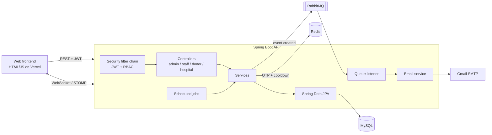

# Blood Bank Management System — Backend

REST API that runs the day-to-day work of a blood bank: donor registration, donation events, lab testing, blood-component separation, inventory, and blood requests from hospitals.

**Java 17 · Spring Boot 3 · Spring Security + JWT · MySQL · Redis · RabbitMQ · WebSocket (STOMP) · Docker**

| | |
|---|---|
| Live demo | https://bloodbank-vn.vercel.app (demo accounts are listed on the login page) · [frontend source](https://github.com/kiins3/bloodbank-web) |
| API | https://bloodbank-api-i4a4.onrender.com/swagger-ui.html (free tier: the first request after idle takes about a minute) |
| Size | ~95 endpoints · 16 JPA entities · 5 roles · ~10k lines of Java |

---

## What it does

| Role | Main features |
|---|---|
| **Donor** | Sign up, register for donation events, get a QR-code ticket by email, see donation history and lab results |
| **Staff – Technical** | Check donors in at events, record donations, enter lab results, separate whole blood into red cells / platelets / plasma, print bag labels |
| **Staff – Inventory** | Manage stock and storage equipment, match blood bags to hospital requests, ship them, handle returns, export dispatch notes to Excel |
| **Hospital** | Create blood requests (normal / urgent), follow their status, confirm delivery or return bags |
| **Admin** | Manage staff, hospitals and events, assign staff to events, dashboards and statistics, audit log |

A blood bag moves through a 12-state lifecycle (awaiting test → awaiting separation → ready → shipped → used / returned / discarded…). A hospital request moves through 10 states, including partial approval and partial return.

## Technical highlights

- **Role-based access control:** stateless JWT authentication; Spring Security filter chain restricts each URL group (`/api/admin/**`, `/api/staff/**`, `/api/donor/**`, `/api/hospital/**`) to its roles. Custom 401/403 handlers return JSON errors.
- **Redis for one-time passwords:** password-reset OTPs live in Redis with a 5-minute TTL; a second key enforces a 60-second resend cooldown.
- **RabbitMQ for bulk email:** creating an event publishes a message to a durable queue. A listener pages through donors (100 at a time) and emails each one, so the HTTP request returns immediately. A failing message is retried, up to 3 attempts, 3 seconds apart.
- **Real-time notifications:** WebSocket/STOMP topics push urgent hospital requests, request status changes and equipment alerts to the staff and admin dashboards.
- **Scheduled jobs:** hourly job opens and closes events automatically; daily jobs email the admin when stock per blood type falls below a threshold and when bags expire within 48 hours.
- **Documents:** Excel dispatch notes (Apache POI) and QR-code tickets (ZXing).
- **Audit trail:** staff actions are recorded in an action log.

## Architecture



## Run it locally

Requirements: Docker Desktop.

```bash
git clone https://github.com/kiins3/BloodBankManager.git
cd BloodBankManager
cp .env.example .env        # optional: add mail credentials, change the admin password
docker compose up -d --build
```

| Service | URL |
|---|---|
| API | http://localhost:8080 |
| Swagger UI | http://localhost:8080/swagger-ui.html |
| Health check | http://localhost:8080/actuator/health |
| RabbitMQ console | http://localhost:15673 (guest / guest) |
| MySQL | localhost:3307 (root / `DB_PASSWORD`) |

Load demo data (campaigns, donors, blood bags through every stage, hospital requests) by walking the real API:

```bash
python scripts/seed_demo.py
```

It creates `doctor@`, `nurse@`, `tech@`, `inventory@`, `hospital@` and `donor@bloodbank.local` (password `123456`).

On first start the app creates an admin account from `ADMIN_EMAIL` / `ADMIN_PASSWORD` (defaults: `admin@bloodbank.local` / `Admin@123`). Donors sign up through `POST /auth/sign-up`.

### Try it with curl

```bash
# Log in as admin
TOKEN=$(curl -s -X POST localhost:8080/auth/login \
  -H 'Content-Type: application/json' \
  -d '{"email":"admin@bloodbank.local","password":"Admin@123"}' | jq -r .accessToken)

curl -H "Authorization: Bearer $TOKEN" localhost:8080/api/admin/general-stat   # 200
curl localhost:8080/api/admin/general-stat                                     # 401
```

### Run without Docker

Start MySQL, Redis and RabbitMQ yourself, set the variables from `.env.example` in your shell or IDE, then:

```bash
./mvnw spring-boot:run
```

## Deploy

Free setup on Render + TiDB Cloud (MySQL compatible) + CloudAMQP, with a Render Blueprint: see [DEPLOY.md](DEPLOY.md).

## Configuration

Everything secret comes from environment variables. See [`.env.example`](.env.example).

| Variable | Purpose |
|---|---|
| `DB_URL`, `DB_USERNAME`, `DB_PASSWORD` | MySQL connection |
| `JWT_SECRET` | HS256 signing key, at least 32 characters |
| `ADMIN_EMAIL`, `ADMIN_PASSWORD` | Root admin created on first start |
| `CORS_ALLOWED_ORIGINS` | Frontend origins allowed to call the API and WebSocket |
| `MAIL_USERNAME`, `MAIL_PASSWORD` | Gmail SMTP (App Password). Optional |
| `REDIS_HOST`, `REDIS_PORT`, `REDIS_PASSWORD`, `REDIS_SSL` | Redis |
| `RABBITMQ_URL` or `RABBITMQ_HOST`/`_USERNAME`/`_PASSWORD` | RabbitMQ |

## Project structure

```
src/main/java/com/blood
├── controller/   admin · staff · donor · hospital · shared APIs
├── service/      business logic
├── repository/   Spring Data JPA repositories and projections
├── model/        JPA entities and status enums
├── dto/          request / response objects
├── security/     JWT provider, filter, Spring Security config
├── component/    scheduled jobs, RabbitMQ listener, data seeder
├── config/       CORS, WebSocket, RabbitMQ, Excel export
└── helper/       QR code generator
```

## Author

**Tran Hai Dang** — Backend Developer · [GitHub](https://github.com/kiins3) · tranhaidang1128@gmail.com
